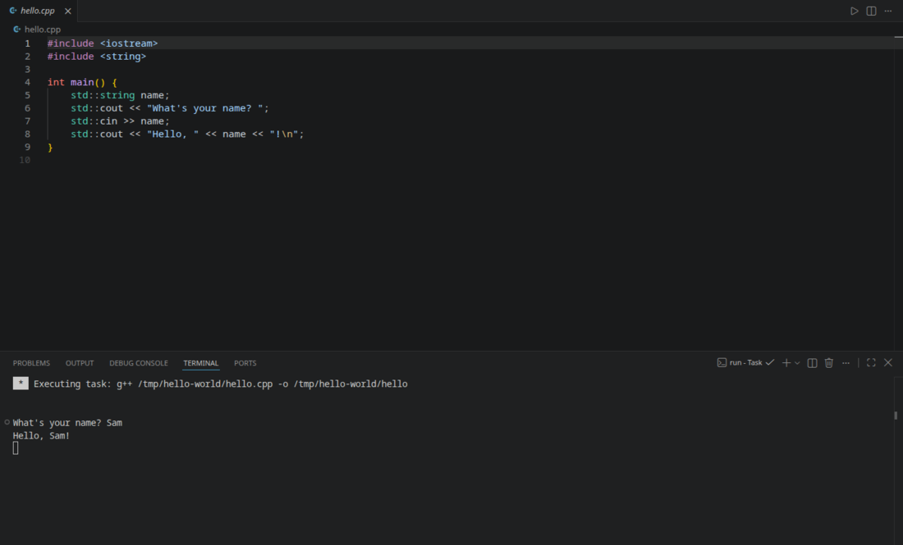

# C++ Run Button

A ▶ button in the editor title bar that compiles the C++ file you have open and runs it. Clicking it does the
same as typing these two commands in the file's folder:

```sh
g++ hello.cpp -o hello
./hello
```

It works in VS Code and VSCodium. It is tested on Linux and written to work on macOS and Windows as well.



## Features

- **One click:** saves the file, compiles it, and runs the program if it compiled.
- **Interactive:** the program runs in the terminal panel, so `std::cin` works and you can type input.
- **The program runs from the file's folder**, so relative paths like `std::ifstream("input.txt")` open files next
  to your source, even when you opened just the file and no folder.
- **Click again to restart:** a program still waiting for input is stopped before the new build starts.
- **No dependencies:** nothing to install besides a compiler, and no shell commands, so file names with spaces
  are fine.

## Requirements

A C++ compiler on your `PATH`, `g++` by default:

| System | Install |
| --- | --- |
| Linux | `g++` from your distribution, e.g. `sudo dnf install gcc-c++` or `sudo apt install g++` |
| macOS | `xcode-select --install` (installs Apple's `g++`, which is Clang) |
| Windows | [MSYS2](https://www.msys2.org/) with the MinGW-w64 toolchain, then add its `bin` folder (e.g. `C:\msys64\ucrt64\bin`) to `PATH` |

Open a new terminal and check with `g++ --version`.

## Installing

1. Download `cpp-run-button-<version>.vsix` from the [releases page](https://github.com/xalrk/cpp-run-button/releases).
2. In the editor, open the Command Palette (`Ctrl+Shift+P`, or `Cmd+Shift+P` on macOS), run
   **Extensions: Install from VSIX...** and pick the file.

## Usage

Open a `.cpp` file and click ▶ in the top right corner of the editor, or run **C++: Build and Run C++ File** from
the Command Palette. The compiler's messages and your program's output appear in the terminal panel. If the build
fails, nothing is run.

To give it a keyboard shortcut, open **Preferences: Open Keyboard Shortcuts**, search for
`cppRunButton.run` and pick a key.

The executable is written next to the source file (`hello` or `hello.exe`). You may want to add these to your
`.gitignore`.

## Settings

| Setting | Default | Description |
| --- | --- | --- |
| `cppRunButton.compiler` | `"g++"` | Compiler to run: a name on your `PATH` (`g++`, `clang++`) or a full path. |
| `cppRunButton.compilerArgs` | `[]` | Extra arguments placed before the file name, e.g. `["-std=c++20", "-Wall", "-O2"]`. |

Each file is compiled on its own. For projects with several `.cpp` files, use a build system such as CMake.

## Restricted Mode

Building and running code is turned off in folders you haven't trusted (VS Code's
[Workspace Trust](https://code.visualstudio.com/docs/editor/workspace-trust)), because compiling and running
someone else's code is not safe.

## Building from source

The extension has no npm dependencies, and neither does packaging it:

```sh
node scripts/package.js          # writes cpp-run-button-<version>.vsix
```

The tests run inside a real editor, once with a folder open and once with loose files. They need `g++` and a
desktop session, and `VSCODE_BIN` must point at the editor's main executable (not the `bin/code` or
`bin/codium` launcher script, which exits without waiting for the tests):

```sh
VSCODE_BIN=/path/to/VSCodium-linux-x64/codium node test/runTest.js
```

## License

[MIT](LICENSE)
